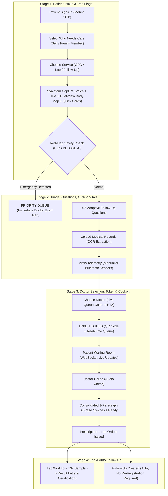

# 🏥 MediKiosk

[](https://opensource.org/licenses/MIT)
[](https://nodejs.org)
[](https://reactjs.org)
[](https://vitejs.dev)

**MediKiosk** is a state-of-the-art, AI-powered first-mile patient intake, automated clinical triage, real-time queue orchestration, and clinical decision support system designed for modern hospitals and Outpatient Departments (OPD).

---

## 🚨 The Challenge in Hospital OPDs
In Indian and global healthcare facilities, physicians spend up to **50% of consultation time** manually recording basic medical histories, reading paper prescriptions, deciphering handwritten records, and logging routine vital signs. This creates long waiting queues, physician burnout, and risks missing acute red-flag emergencies in crowded waiting rooms.

**MediKiosk** transforms this first mile of care through an intelligent, self-service patient kiosk and connected clinician suite that captures symptoms, runs safety-first red-flag triage, extracts prior medical records via multimodal OCR, and synthesizes everything into a **single 30-second clinical summary paragraph** before the patient even steps into the doctor's office.

---

## 🔄 End-to-End Clinical Flowchart



---

## 🩺 Core Capabilities & Modules

### 1. First-Mile Patient Kiosk (`/` & `/intake`)
*   **Mobile OTP Sign-in:** Instant patient authentication supporting consultations for **Self** or **Family Members** (Child, Parent, Spouse, Dependant).
*   **Interactive Anatomical Body Map:** Dual-view (Anterior / Posterior) SVG body mapping allowing patients to tap exact pain locations, select severity (*Mild, Moderate, Severe*), and characterize pain qualities (*Throbbing, Sharp, Dull, Burning, Radiating, Cramping, Stiffness*).
*   **Rule-First Red Flag Engine:** Immediate rule-based detection for critical emergencies (severe chest pain, sudden numbness/paralysis, hemoptysis, acute dyspnea) running **BEFORE** any LLM interaction to prevent catastrophic delays.
*   **Adaptive Clinical Questions:** Dynamic follow-up inquiries targeted strictly at missing clinical data (onset, progression, triggers).
*   **Multimodal OCR Record Ingestion:** Upload past prescriptions, lab reports, and discharge summaries with automated extraction of medications, dosages, and diagnostic baselines.
*   **Kiosk Vitals Telemetry:** Integrated telemetry capture for Blood Pressure, Heart Rate, SpO2 Oxygen, and Body Temperature.

### 2. Doctor Clinical Cockpit & Decision Suite (`/doctor`)
*   **Prioritized Queue Management:** Dual-tiered queue dividing **Emergency Red-Flag Priority** from **Routine OPD Patients**, displaying live positions and dynamic wait ETAs.
*   **Consolidated 1-Paragraph Case Synthesis:** Unified 30-second clinical synthesis combining patient chief complaints, localized body map pain zones, answered adaptive triage questions, and OCR-extracted prior prescriptions into **one comprehensive, objective paragraph**.
*   **Deep-Dive Cards:** Side-by-side inspection cards for exact adaptive questions & answers, as well as uploaded prior records and OCR extractions.
*   **Audio Patient Chime:** One-click calling that triggers an acoustic notification and real-time WebSocket alert on the patient's screen.
*   **Electronic Prescription & Lab Order Pad:** Rapid order pad for hospital pathology investigations (CBC, ESR, LFT, KFT, Blood Sugar, Lipid Profile, Urine Routine).
*   **Automated Follow-Up Scheduling:** Zero re-registration follow-up bookings (3 days, 1 week, 2 weeks, 1 month) automatically recorded to the patient's EMR.

### 3. Pathology & Diagnostic Lab Station (`/lab`)
*   **Workorder Queue:** Live feed of pending laboratory investigations ordered from doctor OPD cockpits.
*   **Specimen QR/Barcode Tracking:** Barcode scanning and specimen collection verification.
*   **Diagnostic Result Certification:** Numerical result entry with automated reference range checks, abnormality flagging, and real-time encounter status synchronization from `lab-pending` to `completed`.

### 4. Strict Role Isolation & Switcher
*   **Patient Kiosk:** Exclusively scoped to intake, waiting room queue tokens, vitals, active prescriptions, and privacy consent.
*   **Doctor Station:** Clinical EMR, prioritized triage queues, prescription pad, and AI review.
*   **Lab Technician:** Pathology workorders, sample barcodes, and lab test certification.
*   **Top Bar Persona Switcher:** Dedicated role-switcher pill for hospital testing and demonstration.

---

## 🛠️ Technical Stack & Architecture

### Frontend
*   **Framework:** React 19 + Vite
*   **Styling:** Tailwind CSS with fluid Dark / Light theme support
*   **Icons:** Lucide React
*   **Real-Time Comms:** Socket.io Client (real-time queue countdowns and call chimes)
*   **Document & QR:** `qrcode.react`, `jspdf`, `jspdf-autotable`
*   **Identity:** Clerk Authentication Protocol

### Backend
*   **Runtime:** Node.js + Express.js
*   **Database:** MongoDB Atlas (Mongoose ODM)
*   **WebSockets:** Socket.io Server for bidirectional queue and triage broadcasting
*   **AI Models:** Groq LLaMA-3 (70B) & Gemini 2.5 Flash for multimodal OCR and assistive clinical synthesis
*   **OCR Pipeline:** Cascading vision extraction (Gemini Vision $\to$ Groq Vision $\to$ Local Tesseract.js)

---

## 📁 Repository Structure
```bash
MediKiosk/
├── backend/                  # Node.js + Express backend service
│   ├── src/
│   │   ├── models/           # MongoDB schemas (Encounter, QueueToken, LabResult, UserProfile)
│   │   ├── routes/           # REST endpoints (intake, queue, summary, lab-orders, encounters)
│   │   ├── services/         # Core logic (clinicalSummaryService, redFlagEngine, questionEngine, queueService)
│   │   └── utils/            # AI helpers, RAG engine, Groq/Gemini client wrappers
│   └── server.js             # Express + Socket.io server entrypoint
├── frontend/                 # React frontend application
│   ├── src/
│   │   ├── components/       # InteractiveBodyMap, RoleHeaderSwitcher, Sidebar, ThemeToggle
│   │   ├── context/          # RoleContext, ThemeContext
│   │   ├── pages/            # PatientIntake, DoctorDashboard, LabDashboard, WaitingRoom, Dashboard
│   │   └── config/           # API and endpoint configurations
│   └── vite.config.js        # Vite bundler configuration
└── README.md
```

---

## 🚦 Getting Started

### 1. Prerequisites
*   Node.js (v18.x or higher)
*   MongoDB Atlas cluster

---

### 2. Configuration & Environment Variables

#### Backend Configuration (`backend/.env`):
```env
PORT=5000
MONGODB_URI=your_mongodb_atlas_connection_string
GROQ_API_KEY=your_groq_api_key
GEMINI_API_KEY=your_gemini_api_key
CLERK_SECRET_KEY=your_clerk_secret_key
```

#### Frontend Configuration (`frontend/.env.local`):
```env
VITE_CLERK_PUBLISHABLE_KEY=your_clerk_publishable_key
VITE_API_URL=http://localhost:5000/api
```

---

### 3. Installation & Run Commands

#### Start Backend:
```bash
cd backend
npm install
node server.js
```
The server runs on **`http://localhost:5000`**.

#### Start Frontend:
```bash
cd frontend
npm install
npm run dev
```
Open **`http://localhost:5173`** in your browser.

---

## 📄 License
This project is licensed under the MIT License.
